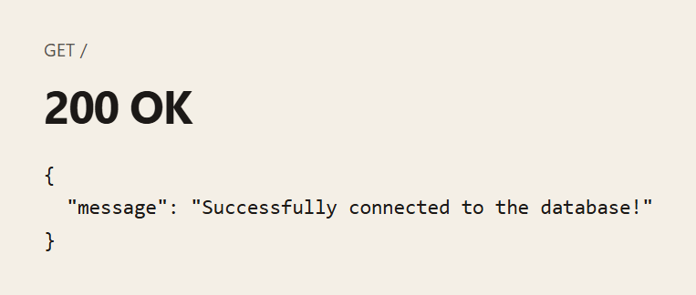
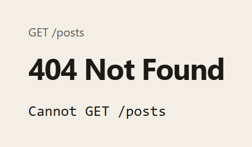

# Social Media API

An Express server that checks a MongoDB connection. The only route is `GET /`. Each request connects with `MONGO_URI`, sends JSON, and then closes the client. There are no user, post, or comment routes.

There is no HTML page. The first screenshot is the JSON `GET /` returned while the server was running. The second is the text from Express’s default page for a path that is not defined.

## Screenshots

**Connected.** `GET /` returns 200 when MongoDB accepts the connection.



**Missing route.** Any other path, such as `GET /posts`, returns Express’s 404 page.



## Getting started

```bash
npm install
npm start
```

The server reads `.env` and listens on `http://localhost:3001` unless `PORT` is set.

| Variable | Purpose |
| --- | --- |
| `MONGO_URI` | MongoDB connection string |
| `PORT` | Port for Express. Defaults to 3001 |

| Command | What it does |
| --- | --- |
| `npm start` | Run `server.js` with Node |
| `npm run dev` | Run `server.js` with nodemon |

## Routes

### `GET /`

Connects to MongoDB and returns:

```json
{
  "message": "Successfully connected to the database!"
}
```

The status is `200`. If the connection fails, the status is `500` and the body is `{ "message": "Failed to connect to the database." }`. The client is closed after every request.

Any other method or path is not defined. Express responds with status `404` and a page that says `Cannot GET /posts` (or the matching method and path).
